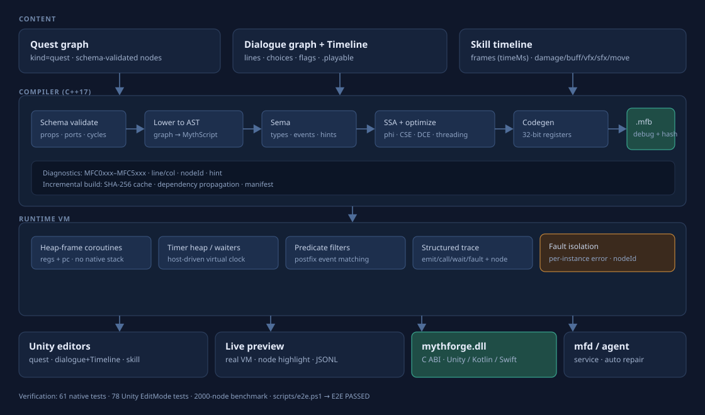

# MythForge

**面向游戏内容工业化的「内容编译管线 + 协程 VM + Unity 工具链」。**

把任务、剧情、技能三类内容从 JSON 图编译成可校验的寄存器字节码，在确定性协程 VM 中执行，
并通过 C ABI 复用到 Unity 编辑器、实时预览、内容服务和演示游戏。

[](https://github.com/SeupLio/mythforge/actions/workflows/ci.yml)




## 这是什么

MythForge 不是“任务系统 Demo”，而是一条完整的内容生产工具链：

- **图只是前端**：任务/剧情/技能图统一降级为 MythScript AST，再走语义分析、SSA 优化、
  寄存器字节码生成，图和手写脚本共享同一套语义与诊断。
- **运行时只有一份**：C++ 协程 VM 通过 `mythforge.dll` 暴露 C ABI，Unity（P/Invoke）、
  Kotlin（JNA）、Swift（module map）复用同一份 `.mfb`。
- **工具链闭环**：编辑器校验/预览/构建 → `mf` 批量编译 → `mfd` 内容服务 → `mf agent fix`
  自动修复 → Unity 实时预览与演示游戏。
- **可验证**：61 个原生测试、78 个 Unity EditMode 测试、2000 节点性能实测、
  ASan/UBSan、libFuzzer harness 与一条 `scripts/e2e.ps1` 全链路脚本。

## 为什么做（与岗位的对应）

| 岗位关注点 | 项目落点 |
|---|---|
| 大型项目海量内容的工业化工具 | schema 驱动编辑、增量构建、内容服务、批量回归 |
| 战斗 / 关卡 / 剧情演出 / 任务 | 任务图、剧情图 + Timeline、技能时间轴三套节点与 lowering |
| 提升内容生产效率 | 实时预览、节点高亮、Agent 修复、一条命令 e2e |
| 工具稳定性与易用性 | 诊断码 + 节点定位、撤销重做、CI、Sanitizer、fuzz |
| C 系语言 / 编译原理 / 数据结构 | C++17 编译器、SSA + 支配边界、寄存器字节码、堆/队列 |
| Unity / Unreal | Unity 2022.3 GraphView、UI Toolkit、IMGUI、Timeline 反射联动 |
| AIGC / AI Agent | schema 驱动的修复 Agent，保留 remaining diagnostics 供 LLM 二次决策 |

## 能力清单

### 1. 内容编译器（C++17）

```
JSON graph → schema validate → lower to MythScript → sema
          → CFG + SSA (phi / CSE / DCE / jump threading)
          → 32-bit register bytecode → .mfb (debug table + SHA-256)
```

- 三类内容：`quest`、`dialogue`、`skill`；技能帧按 `timeMs` 有序。
- 校验：必填属性、端口度数、单入口、无环、可达、能否到达出口、技能时间倒序。
- 诊断：`MFC0xxx–MFC5xxx`、行列号、图节点 ID、修复建议。
- 增量构建：SHA-256 内容寻址 + 依赖传播 + 版本化缓存。

### 2. 协程 VM

- 每个脚本实例是堆上的寄存器帧 + pc，`wait` 只挂起，不占原生栈。
- 定时器最小堆、事件 waiters、postfix 谓词过滤。
- 宿主推进虚拟时钟，保证确定性与可重放。
- 结构化 trace：`emit / call / wait / fault` + `nodeId`，供预览高亮与遥测。

### 3. Unity 工具链

- 任务图编辑器、剧情图编辑器（Timeline 联动）、技能时间轴编辑器。
- 实时预览窗口：真实 VM 驱动、播放/暂停/步进、事件注入、节点高亮、JSONL 遥测。
- 撤销/重做、搜索、诊断定位、`mf check` / `mf sim` / `mf build` 集成。
- 演示游戏：`Assets/Scenes/MythForgeDemo.unity`，同时驱动任务/剧情/技能三个 VM。

### 4. 运行时 SDK

- `native/sdk/include/mf_sdk.h`：C ABI，不暴露 STL。
- Unity：`MfNativeVm` / `MfPlaySession` / `MfDemoSession`。
- Kotlin（JNA）、Swift（module map）参考绑定。
- 拉取式 JSON trace，避免跨语言回调生命周期问题。

### 5. 内容服务与 Agent

- `mfd`：`/health`、`/manifest`、`/content`、`/modules`、`/modules/{id}`、
  `/validate`、`/compile`、`/agent/fix`。
- `mf agent fix`：补必填属性、纠类型、clamp 负数、修枚举、重排技能帧、补入口出口；
  Timeline 资产、flag、剧情文本等设计值保持为空并显式报告。

## 快速开始

要求：CMake ≥ 3.20、C++17 编译器（Windows：MSVC 或 MinGW-w64）。

```bash
cmake -S . -B build -DCMAKE_BUILD_TYPE=RelWithDebInfo
cmake --build build -j
ctest --test-dir build --output-on-failure
```

```bash
# Windows 下可执行文件为 mf.exe / mfd.exe
./build/native/mf validate content
./build/native/mf build    content
./build/native/mf test     content
./build/native/mf dsl      content/quests/q_forest_wolves.json
./build/native/mf agent fix content/quests/q_forest_wolves.json --json
./build/native/mfd content --port 7788
```

Unity：

1. Unity Hub 添加编辑器 2022.3.62f3c1，打开 `unity/DemoGame`。
2. 菜单 `MythForge/任务图编辑器`、`剧情编辑器`、`技能时间轴编辑器`、`实时预览`。
3. `MythForge/同步运行时内容到 StreamingAssets` → `MythForge/创建演示场景` → 打开
   `Assets/Scenes/MythForgeDemo.unity` 进入 Play。

全链路：

```powershell
./scripts/e2e.ps1              # 原生 + 内容 + Agent + mfd + Unity
./scripts/e2e.ps1 -SkipUnity   # 跳过 Unity
```

## 验证结果

| 项目 | 结果 |
|---|---|
| 原生单元/集成测试 | **61 tests / 100278 checks / 0 failed** |
| 内容流水线 | validate 4/4、build 4、test 5 passed |
| Unity EditMode | **78 passed / 0 failed** |
| 2000 节点 GraphView | 热路径模型 193 ms、校验 239 ms、Rebuild 812 ms；冷启动 2.8–3.2 s |
| 全链路 | `scripts/e2e.ps1` → `E2E PASSED` |
| 工具链 | GitHub Actions：Linux / Windows / ASan+UBSan |

详细数据：[docs/bench/slice-a.md](docs/bench/slice-a.md)、
[docs/bench/m2-editor.md](docs/bench/m2-editor.md)、
[docs/bench/slice-b.md](docs/bench/slice-b.md)。

## 核心技术

- **图 lowering**：图只负责描述，统一降级到 AST，保证编辑器/CLI/CI 单一语义。
- **SSA**：Cytron 支配边界插 phi、支配树重命名、常量折叠、CSE、DCE、跳转线程化；
  codegen 处理 phi 并行复制与临界边拆分。
- **寄存器字节码**：32 位定长指令，255 寄存器 / 256 常量上限，超限给出拆 chunk 诊断。
- **协程 VM**：堆帧、ready queue、timer heap、event waiters、谓词程序，确定性虚拟时钟。
- **调试表**：`pc → 源码行/列/图节点`，预览高亮与诊断定位共用。
- **C ABI**：不透明句柄、UTF-8、调用方错误缓冲区、拉取式 trace、单 VM 单线程。
- **工具性能**：消除 O(n²) ID 生成；区分数据层/视图层耗时；视口裁剪是下一步。

架构取舍见 [docs/adr](docs/adr)，面试材料见
[docs/interview/mythforge-interview.md](docs/interview/mythforge-interview.md)。

## 仓库结构

```
mythforge/
├─ schema/node_types.json     # 节点类型、属性约束、端口度数
├─ content/                   # 任务/剧情/技能示例与回归用例
├─ native/
│  ├─ mfc/                    # JSON/SHA-256/词法/语法/语义/IR/优化/字节码/图
│  ├─ mfvm/                   # 协程 VM、Host 接口、结构化 trace
│  ├─ sdk/                    # C ABI + Unity/Kotlin/Swift 绑定
│  ├─ tools/mf/               # CLI：validate/build/test/sim/check/agent
│  ├─ tools/mfd/              # 本地内容服务
│  └─ tests/                  # 61 个测试 + libFuzzer harness
├─ unity/                     # 编辑器 + 运行时 + 演示游戏
├─ scripts/e2e.ps1            # 全链路验证
├─ docs/adr/                  # 架构决策记录
├─ docs/bench/                # 基准与复现命令
└─ docs/interview/            # 自我介绍 / STAR / 技术原理
```

## 已知限制

- v1 只支持线性内容链；分支需要 VM 的 `parallel/race` 与图编辑器多出边。
- Kotlin/Swift 绑定是参考实现，未在本机编译；Unity 路径已实测。
- 热更等价于重新加载模块；崩溃上报是 VM fault trace + JSONL，不是进程级 SDK。
- `mfd` 单线程、无 TLS、仅监听 127.0.0.1，定位是工具链内容服务。
- 2000 节点 Rebuild 是压测上界，不是常规内容规模，也不是帧率。

## License

[MIT](LICENSE)
